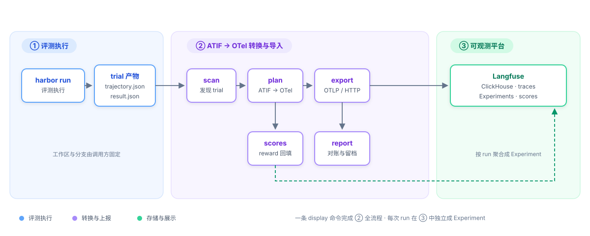

# harborstack

把 [harbor](https://github.com/ivanbao9783/harbor) 的评测产物直接变成可直接观测的分布式追踪，写进 Langfuse —— 一条命令起栈，一条命令导入，用户无需了解 OTel、OTLP、ClickHouse 这些底层概念。

## 它解决什么问题

harbor 跑完评测后留下一堆 `agent/trajectory.json`（ATIF 格式）。这些文件能看，但看不出「模型在第几步、调了什么工具、耗时多少、哪一步失败」。

harborstack 做三件事：

1. **一键部署** Langfuse 全家桶（web / worker / clickhouse / minio / postgres / redis），端口自动避让，健康门禁把关
2. **把 ATIF 转成 OTel spans**，语义严格对齐：生成步对应 generation，工具调用对应 tool span，并行调用按 `source_call_id` 精确配对
3. **导入后可查可筛**：每次评测是一个独立的 Experiment，reward 直接回填为 score

## 端到端流程



## 快速开始

### 前置条件

- Linux + Docker（含 `docker compose` 插件）
- Python 3.10+
- 一份可用的 harbor 工作区（`run` 依赖它；只用 `display` 看已有产物时可跳过）
- `aarch64` 且 CPU 无 RCpc 时会自动对 ClickHouse 二进制做指令穿刺（x86 会跳过）

### 1. 安装 harborstack

```bash
git clone https://github.com/ivanbao9783/harbor-otel-stack && cd harbor-otel-stack
uv sync
```

如果 PyPI 访问慢，改用镜像：

```bash
UV_DEFAULT_INDEX=https://repo.huaweicloud.com/repository/pypi/simple uv sync
```

### 2. 准备 harbor 工作区

harborstack 只调用现成的 harbor，不负责 clone、切分支和装依赖：

```bash
git clone https://github.com/ivanbao9783/harbor ~/code/harbor
cd ~/code/harbor && git checkout <固定的 tag 或 commit> && uv sync
cd -
```

默认从 `~/code/harbor` 查找。仓库放在别处时，用以下任一方式告知：

```bash
export HARBORSTACK_PATHS__HARBOR_REPO=/path/to/harbor   # 环境变量
uv run harborstack run --set paths.harbor_repo=/path/to/harbor -- ...  # 单次覆盖
```

也可以直接改 `harborstack.toml` 的 `[paths].harbor_repo`。该仓需要满足两点：根目录有 `pyproject.toml`，且 `harbor` 可执行文件存在于 `<repo>/.venv/bin/harbor`、`$UV_PROJECT_ENVIRONMENT/bin/harbor` 或 `PATH` 上。

### 3. 体检

```bash
uv run harborstack doctor
```

全新环境会有 `warn`（镜像未拉取、补丁未缓存），这是正常的；`fail` 必须为 0。

### 4. 起栈

```bash
uv run harborstack init
```

成功后输出访问地址与登录账号：

```
[ok  ] volumes      无历史数据卷，可安全初始化
[ok  ] langfuse_web 按 tag 拉取后 digest 校验通过
[skip] minio        已就绪 sha256:451fe6858cb770cc9…
[ok  ] clickhouse_patch 本机无需穿刺，跳过
[ok  ] ports        web=18930，worker=18900，…
[ok  ] render       /path/to/var/.env
[ok  ] compose      config 校验通过
[ok  ] up           项目 harborstack-default 已启动

[ok  ] containers   …
[ok  ] clickhouse   SELECT 1 通过
[ok  ] web          /api/public/health 200（端口 18930）
[ok  ] events_full  …

Langfuse   http://localhost:18930
登录账号   admin@harborstack.local
端口分配   web=18930，worker=18900，…
```

默认账号见 `harborstack.toml` 的 `[langfuse].admin`。

### 5. 跑评测

`--` 之后原样传给 harbor：

```bash
uv run harborstack run -- -c config.yaml -t ./task
```

相对路径按你当前所在目录解析；没有指定 `-o/--out` 时，产物会自动落到 `var/runs/<id>`，不会写进 harbor 仓。只想验证路径与命令、不真正开跑，可加 `--dry-run`。

### 6. 导入轨迹

```bash
uv run harborstack display path/to/run_dir
```

`run_dir` 可以是整个 run 目录（批量导入所有 case），也可以是单个 trial 目录。导入后打开 Langfuse，在 **Experiments** 页按 run 分组查看。

## 命令一览

| 命令 | 作用 |
|---|---|
| `doctor` | 环境体检，11 项检查 |
| `init` | 拉镜像、打补丁、起栈、健康门禁 |
| `install` | 仅准备镜像与补丁产物（可 `--from-bundle` 离线） |
| `run` | 透传调用 harbor 跑评测 |
| `display` | 扫描产物 → 转换 → 导入 Langfuse |
| `down` | 停栈（默认连数据卷一起删） |
| `bundle create\|verify` | 打包 / 校验离线分发件 |
| `version` | 版本信息 |

除 `version` 外的每个子命令都接受 `--config`（指定配置）、`--set k=v`（覆盖单项，可重复）、`--json`（机器可读输出）和 `--lock`（指定锁文件）；`run`/`display` 不使用 `lock.json`。`--version` 是根命令参数。

退出码：`0` 成功、`2` 参数或调用错误、`3` 配置或环境不满足（含 `doctor` 的 `fail`、`install` 失败、`init` 的任一失败）、`4` 服务不可用（`display` 健康门禁失败或 `down` 失败）、`5` 数据异常（`bundle verify` 不符，以及 `run` 把 harbor 的非 0/2 退出码统一映射为 5）。

## 配置

优先级从高到低：

```
--set key=value  >  环境变量 HARBORSTACK_A__B  >  harborstack.toml  >  代码内置默认
```

环境变量用双下划线表达层级，例如：

```bash
HARBORSTACK_PATHS__HARBOR_REPO=~/code/harbor uv run harborstack run ...
```

常用项：

| 配置 | 说明 |
|---|---|
| `paths.harbor_repo` | harbor 工作区路径，`run` 子命令依赖 |
| `stack.env` | compose 项目名后缀，同机多套实例靠它隔离 |
| `ports.range` | 端口分配区间，只绑 `127.0.0.1` |
| `langfuse.security_mode` | `generated`（随机密钥）或 `default`（固定口令） |
| `export.mode` | `full` 保留完整属性（单个字符串超过 65536 字符会截断），`structural` 只报结构与长度/哈希 |

## 安全提示

`security_mode = "default"` 使用固定弱口令，仅适用于「只绑回环、单机调试」场景。需要长期运行时请改为 `generated`，首次 `init` 会生成随机密钥并写入 `var/secrets.json`（0600）。

改了 `security_mode` 会触发密钥重建，与已有数据卷内的数据库凭证失配。`init` 会在检测到这种组合时直接报错，此时要么恢复原 `secrets.json`，要么 `down` 删卷重来。

## 文档

- [设计文档](docs/design.md) —— 架构、契约、不变量、决策记录
- [全新环境复现手册](docs/runbook-fresh-rebuild.md) —— 从零到跑通的逐步操作

## 开发

```bash
uv sync --extra dev
uv run pytest -q
```

测试是纯 Python 的，不需要 Docker。部分用例断言 POSIX 权限位与 POSIX 路径语义，请在 Linux 或 WSL 下运行；CI 以 `ubuntu-latest` 为准。

## 致谢

上游依赖 [Langfuse](https://langfuse.com)、[ClickHouse](https://clickhouse.com)、以及 harbor 评测框架。

## License

[Apache-2.0](LICENSE)。分发本项目或其离线包时，请一并保留 [NOTICE](NOTICE) 中的第三方声明与修改说明。
